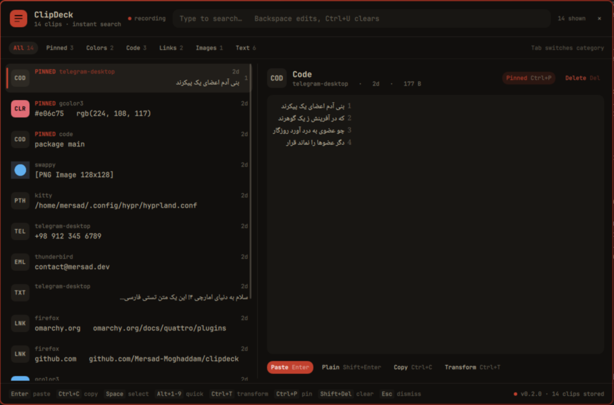
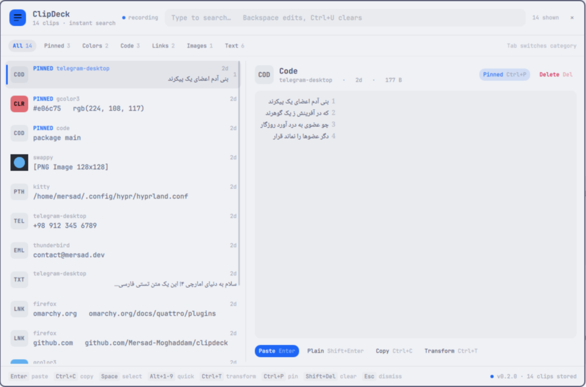

# ClipDeck (Omarchy Shell Plugin)

A beautiful, keyboard-first clipboard manager plugin for [Omarchy](https://omarchy.org/) 4 (Quattro). Persistent history, real-time FTS5 search, rich inspectors, syntax-highlighted code, Persian text & digit tools, and Omarchy theme synchronization.

> [!IMPORTANT]
> **ClipDeck is an Omarchy shell plugin paired with a pure-Go daemon (`clipdeckd`).**
> The UI is loaded directly by `omarchy-shell`, adapts reactively to your active Omarchy theme tokens (`Color.menu.*`, `Style.*`), and communicates with `clipdeckd` over a high-performance Unix domain socket with UID verification.

> [!TIP]
> ClipDeck is submitted to the [Omarchy community plugin marketplace](https://plugins.omarchy.org/) — or install straight from this repository with the one-liner below.

---

## Features

- **Keyboard-First Experience:** Summon instantly via hotkey (`Super+V`), navigate with arrow keys (or Ctrl+J/K), and act with simple key combinations. Every action shows its shortcut inline, and there is no hidden text field — every keystroke searches.
- **Persistent & Fast:** Powered by `clipdeckd` and SQLite FTS5 trigram search — instant sub-millisecond retrieval across tens of thousands of clips.
- **Split-Pane Inspector:** Virtualized clip list on the left with type badges, source application, and freshness stamps. The right pane inspects the selected clip: color swatches with HEX/RGB/HSL rows that copy on click, image previews with dimensions, links with domain chips, code/JSON with themed syntax highlighting, and strict plain-text rendering for everything else.
- **Deep Content Detection:** Automatically classifies content as plain text, code (Go, Rust, Python, JS, C++, HTML, Shell), JSON, colors (HEX, RGB, HSL), links, file paths, emails, and phone numbers.
- **Live Theme Synchronization:** The daemon never bakes colors into stored previews — it emits class-based markup that the overlay re-colors from the active Omarchy palette on every render. Theme switches apply instantly, and highlighting can never clash with (or override) your theme.
- **Sensitive Data & Expiry:** Detects password manager hints (`x-kde-passwordManagerHint`), tokens, keys, and credentials. Sensitive clips stay masked in the inspector until you press `Ctrl+R`, and show a live TTL countdown when they expire.
- **Multi-Select & Merge:** `Space` toggles selection, `Ctrl+A` selects everything visible, and `Enter` merges the selection into one clip (newline, space, or comma separators) and copies it.
- **Quick Paste:** `Alt+1..9` pastes one of the first nine visible clips immediately.
- **Persian & RTL Language Support:**
  - Automatic right-to-left rendering with Persian-friendly line height.
  - One-click transformations: Persian digits ⇄ Latin, Arabic yeh/kaf normalization, ZWNJ (نیم‌فاصله) standardization.
- **Transformations Suite:** UPPERCASE, lowercase, camelCase, snake_case, JSON formatting, base64 encode/decode, URL encode/decode, line sorting, and deduplication — with a live preview before you apply.
- **Direct Paste Dispatcher:** Paste directly into active Wayland windows (`wtype` / `hyprctl dispatch sendshortcut`) or copy to the system clipboard.
- **Status Bar Widget:** Live clip counter fed by daemon events, urgent tint while capture is paused, and a tooltip that spells out the state. Left click summons the deck; middle/right click toggles pause.

---

## Keyboard Shortcuts

| Shortcut | Action |
|---|---|
| <kbd>Enter</kbd> | Paste selected item into active window |
| <kbd>Shift</kbd>+<kbd>Enter</kbd> | Paste as plain text |
| <kbd>Ctrl</kbd>+<kbd>Enter</kbd> | Copy only (no paste) |
| <kbd>Alt</kbd>+<kbd>Enter</kbd> | Open link/image/path with the default app |
| <kbd>Ctrl</kbd>+<kbd>C</kbd> / <kbd>Ctrl</kbd>+<kbd>Shift</kbd>+<kbd>C</kbd> | Copy (or copy as plain text) |
| <kbd>Alt</kbd>+<kbd>1</kbd>…<kbd>9</kbd> | Quick paste the first nine visible clips |
| <kbd>Space</kbd> / <kbd>Ctrl</kbd>+<kbd>Space</kbd> | Toggle multi-select (space joins the filter if one is active) |
| <kbd>Ctrl</kbd>+<kbd>A</kbd> | Select all visible clips |
| <kbd>Enter</kbd> (with 2+ selected) | Merge selection & copy (Shift+Enter merges & pastes) |
| <kbd>Ctrl</kbd>+<kbd>P</kbd> | Toggle Pin / Unpin |
| <kbd>Ctrl</kbd>+<kbd>T</kbd> | Open the Transform picker (live preview, Enter copies, Shift+Enter copies & pastes) |
| <kbd>Ctrl</kbd>+<kbd>R</kbd> | Reveal/hide a sensitive clip |
| <kbd>Ctrl</kbd>+<kbd>I</kbd> | Toggle Incognito / pause capture |
| <kbd>Delete</kbd> | Delete selected clip (<kbd>Shift</kbd>+<kbd>Delete</kbd> clears unpinned history, with confirmation) |
| <kbd>Tab</kbd> / <kbd>Shift</kbd>+<kbd>Tab</kbd> | Cycle categories (All, Pinned, Colors, Code, Links, Images, Text) |
| <kbd>↑</kbd>/<kbd>↓</kbd>/<kbd>PgUp</kbd>/<kbd>PgDn</kbd>/<kbd>Home</kbd>/<kbd>End</kbd> | Move the cursor (`Ctrl`+<kbd>J</kbd>/<kbd>K</kbd> works too) |
| <kbd>Backspace</kbd> / <kbd>Ctrl</kbd>+<kbd>U</kbd> | Edit / clear the search filter |
| <kbd>Esc</kbd> | Clear selection → clear filter → dismiss (in that order) |

---

## Theming

ClipDeck renders with the same primitives as the built-in shell surfaces:

- `Border.surfaceSpec("menu", "border", …)` for the card border, so border width, radius, gradient, and opacity follow your theme's `[menu]` style block.
- `Color.menu.*` for background, text, scrim, and selection colors.
- `Color.accent` / `Color.urgent` for emphasis and destructive actions, with on-accent label colors derived by mixing against your palette (never hardcoded white/black).
- Syntax highlighting classes (`t-keyword`, `t-string`, `t-comment`, `t-json-key`, …) are mapped to theme-mixed tones at render time.

Switch themes and the deck follows instantly — no restart, no stale palette in stored previews.


---

## Screenshots





The overlay is built entirely from Omarchy theme tokens, so it restyles live —
no restart — when you switch themes (`omarchy theme set ...`), exactly as in
the two captures above.

---

## Installation

### 1. Install the daemon (`clipdeckd`) — any distro
ClipDeck pairs with the CGO-free Go daemon; every release ships `.deb`,
`.rpm`, `.apk` and a portable tarball for `amd64` and `arm64`
([releases](https://github.com/Mersad-Moghaddam/clipdeck/releases)).
**Use daemon v0.2.1 or newer** — earlier versions shipped a broken
clipboard watcher that never stored captured items:

```bash
# Debian / Ubuntu
sudo apt install ./clipdeck_0.2.1_amd64.deb

# Fedora / RHEL / openSUSE
sudo dnf install ./clipdeck-0.2.1-1.x86_64.rpm

# Alpine
sudo apk add --allow-untrusted ./clipdeck_0.2.1_x86_64.apk

# Arch (AUR)
yay -S clipdeck

# Any distro, portable installer (downloads or --from-source)
curl -fsSL https://raw.githubusercontent.com/Mersad-Moghaddam/clipdeck/main/packaging/install.sh | bash
```

Then enable the user service (package installs enable it for you):

```bash
systemctl --user enable --now clipdeckd
clipdeck doctor   # verify wl-clipboard, wtype, socket, database
```

### 2. Install Omarchy Plugin
Install the shell plugin via the Omarchy CLI:
```bash
omarchy plugin add https://github.com/Mersad-Moghaddam/omarchy-clipdeck.git --enable
```

Or install manually for development:
```bash
git clone https://github.com/Mersad-Moghaddam/omarchy-clipdeck.git ~/.config/omarchy/plugins/io.github.mersadmoghaddam.clipdeck
omarchy-shell shell rescanPlugins
omarchy plugin enable io.github.mersadmoghaddam.clipdeck --section right
```

### 3. Hyprland Keybinding
Add a binding in `~/.config/hypr/bindings.conf` or your Hyprland configuration:
```ini
bind = SUPER, V, exec, omarchy-shell shell toggle io.github.mersadmoghaddam.clipdeck '{}'
```

---

## License

MIT License. See [LICENSE](LICENSE) for details.
