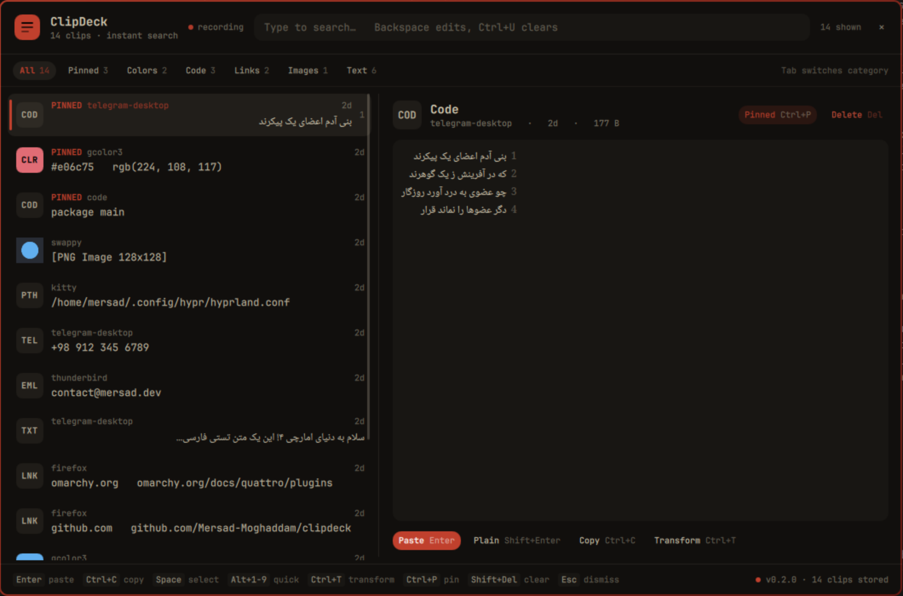

# ClipDeck (Omarchy Shell Plugin)

A beautiful, keyboard-first clipboard manager plugin for [Omarchy](https://omarchy.org/) 4 (Quattro). Persistent history, real-time FTS5 search, rich inspectors, syntax-highlighted code, Persian text & digit tools, and Omarchy theme synchronization.



> [!IMPORTANT]
> **ClipDeck is an Omarchy shell plugin paired with a pure-Go daemon (`clipdeckd`).**
> The UI is loaded directly by `omarchy-shell`, adapts reactively to your active Omarchy theme tokens (`Color.menu.*`, `Style.*`), and communicates with `clipdeckd` over a high-performance Unix domain socket with UID verification.

---

## Features

- **Keyboard-First Experience:** Summon instantly via hotkey (`Super+V`), navigate with arrow keys, and perform operations with simple key combinations.
- **Persistent & Fast:** Powered by `clipdeckd` and SQLite FTS5 trigram search — instant sub-millisecond retrieval across tens of thousands of clips.
- **Split-Pane Inspector:** Virtualized clip list on the left with instant preview, source application badge, type swatches, and timestamps. Full inspection pane on the right.
- **Deep Content Detection:** Automatically classifies content as plain text, code (Go, Rust, Python, JS, C++, HTML, Shell), JSON, colors (HEX, RGB, HSL), links, file paths, emails, and phone numbers.
- **Live Theme Synchronization:** Respects active Omarchy theme palettes (`Color.menu.background`, `Color.accent`, `Color.menu.text`) with zero restarts needed on theme changes.
- **Sensitive Data & Expiry:** Detects password manager hints (`x-kde-passwordManagerHint`), tokens, keys, and credentials, applying automatic TTL purge.
- **Persian & RTL Language Support:**
  - Automatic right-to-left layout and Persian font styling.
  - One-click transformations: Persian digits ⇄ Latin, Arabic yeh/kaf normalization, ZWNJ (نیم‌فاصله) standardization.
- **Transformations Suite:** UPPERCASE, lowercase, camelCase, snake_case, JSON formatting, base64 encode/decode, URL encode/decode, line sorting, and deduplication.
- **Direct Paste Dispatcher:** Paste directly into active Wayland windows (`wtype` / `hyprctl dispatch sendshortcut`) or copy to system clipboard.
- **Status Bar Widget:** Live item counter badge and pause/incognito toggle right on your Omarchy bar.

---

## Keyboard Shortcuts

| Shortcut | Action |
|---|---|
| <kbd>Enter</kbd> | Paste selected item into active window |
| <kbd>Shift</kbd>+<kbd>Enter</kbd> | Paste as Plain Text |
| <kbd>Ctrl</kbd>+<kbd>C</kbd> | Copy selected item to clipboard |
| <kbd>Ctrl</kbd>+<kbd>Shift</kbd>+<kbd>C</kbd> | Copy as plain text |
| <kbd>Ctrl</kbd>+<kbd>P</kbd> | Toggle Pin / Unpin |
| <kbd>Ctrl</kbd>+<kbd>T</kbd> | Open Transform picker |
| <kbd>Ctrl</kbd>+<kbd>I</kbd> | Toggle Incognito / Pause mode |
| <kbd>Delete</kbd> | Delete selected clip |
| <kbd>Shift</kbd>+<kbd>Delete</kbd> | Clear unpinned clipboard history |
| <kbd>Tab</kbd> | Cycle category filters (All, Pinned, Code, Colors, Images, Links, Text) |
| <kbd>Esc</kbd> | Clear search query or close overlay |

---

## Installation

### 1. Install Daemon (`clipdeckd`)
ClipDeck requires the Go backend daemon `clipdeckd`:
```bash
# Build & install via Go
go install github.com/Mersad-Moghaddam/clipdeck/cmd/clipdeckd@latest
go install github.com/Mersad-Moghaddam/clipdeck/cmd/clipdeck@latest

# Enable & start user service
systemctl --user enable --now clipdeckd
```

### 2. Install Omarchy Plugin
Install the shell plugin via the Omarchy CLI:
```bash
omarchy plugin add https://github.com/Mersad-Moghaddam/omarchy-clipdeck.git --enable
```

Or install manually for development:
```bash
git clone https://github.com/Mersad-Moghaddam/omarchy-clipdeck.git ~/.config/omarchy/plugins/io.github.mersadmoghaddam.clipdeck
omarchy-shell shell rescanPlugins
omarchy plugin enable io.github.mersadmoghaddam.clipdeck --section right
```

### 3. Hyprland Keybinding
Add a binding in `~/.config/hypr/bindings.conf` or your Hyprland configuration:
```ini
bind = SUPER, V, exec, omarchy-shell shell toggle io.github.mersadmoghaddam.clipdeck '{}'
```

---

## License

MIT License. See [LICENSE](LICENSE) for details.
